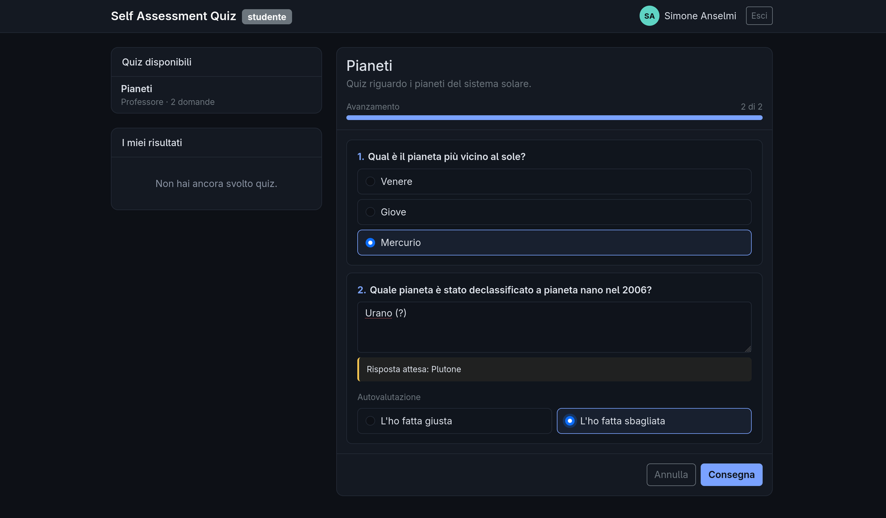
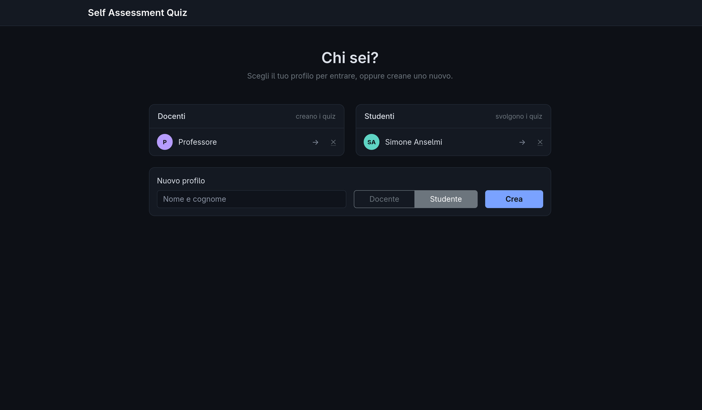
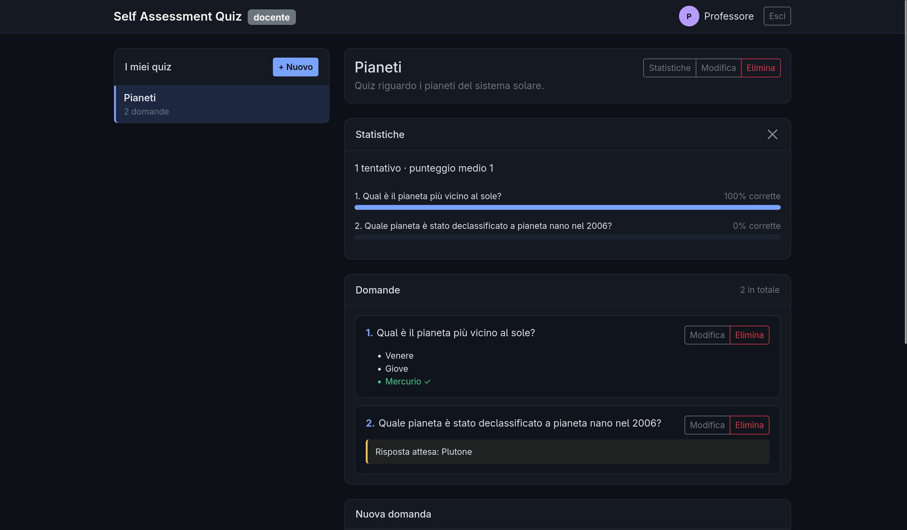
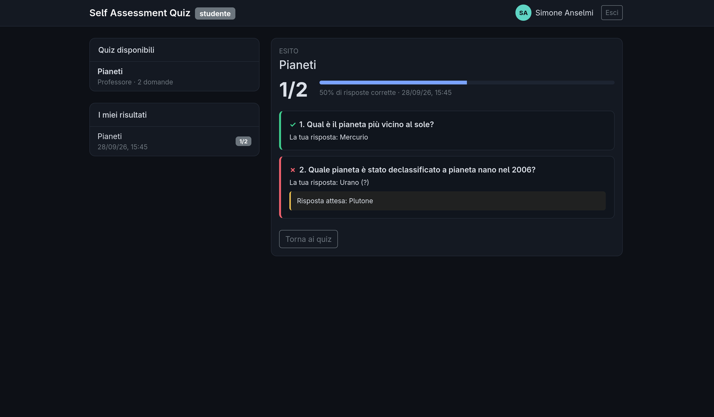

# Self Assessment Quiz

Applicazione web per l'autovalutazione. I docenti creano quiz con domande a scelta multipla e a risposta aperta; gli studenti li svolgono e ricevono subito il punteggio. Le risposte aperte non vengono corrette automaticamente: lo studente confronta la propria risposta con quella attesa e si autovaluta.

Scritta senza framework, in PHP e JavaScript, con un'architettura Model-View-Presenter su entrambi i lati.



## Funzionalità

- **Docente**: crea, modifica ed elimina quiz e domande; consulta le statistiche di ogni quiz (tentativi, punteggio medio, percentuale di risposte corrette per domanda).
- **Studente**: svolge i quiz con una barra di avanzamento e l'evidenziazione delle risposte mancanti; per le domande aperte si autovaluta; rivede lo storico dei propri risultati.
- **Profili**: nessun login, si sceglie o si crea il proprio profilo dalla pagina iniziale.

## Punti tecnici

- **Architettura MVP senza framework.** Frontend e backend seguono entrambi Model-View-Presenter e comunicano solo tramite un'API REST in JSON: il backend non genera HTML e potrebbe essere riscritto in un altro linguaggio senza toccare il frontend.
- **Design pattern.** *Strategy* per la correzione delle risposte (una strategia per tipo di domanda); *Observer* per la comunicazione dalla View al Presenter; *Front Controller* e *Repository* nel backend.
- **Dati.** Schema relazionale con vincoli e cancellazioni a cascata; correzione e salvataggio di un tentativo in un'unica transazione; statistiche calcolate con query aggregate; orari salvati in UTC e convertiti nel fuso dell'utente.
- **Sicurezza di base.** Query parametrizzate, nessun HTML costruito con i dati dell'utente, soluzioni mai inviate allo studente, controllo che ogni quiz venga modificato solo dal suo autore.
- **Test.** 25 test automatici, di unità e di integrazione sull'API reale, in un solo script senza dipendenze.
- **Docker.** L'intero sistema si avvia con un comando.

## Tecnologie

| | |
|---|---|
| Frontend | HTML, CSS, JavaScript; Bootstrap 5 per l'impaginazione |
| Backend | PHP 8.2 senza framework |
| Database | MySQL 8 |
| Esecuzione | Docker Compose (Apache + PHP, MySQL) |
| Diagrammi | PlantUML |

## Anteprima

| | |
|---|---|
|  |  |
| Scelta del profilo | Area docente: quiz, statistiche e domande |
|  |  |
| Svolgimento con autovalutazione | Esito e storico dei risultati |

## Avvio

Serve Docker con Docker Compose.

```bash
git clone https://github.com/simo-ansel/SelfAssessment.git
cd SelfAssessment
docker compose up --build
```

Aprire <http://localhost:8080> quando i container sono avviati (al primo avvio MySQL impiega qualche decina di secondi). Il database parte vuoto: dalla pagina iniziale si creano un docente e uno studente.

Per azzerare i dati: `docker compose down -v && docker compose up --build`.

## Test

Con i container avviati:

```bash
docker compose exec web php tests/test.php
```

## Documentazione

| Documento | Contenuto |
|-----------|-----------|
| [Requisiti](docs/01-requisiti.md) | attori, requisiti funzionali e non funzionali, casi d'uso |
| [Processo di sviluppo](docs/02-processo.md) | modello incrementale, strumenti |
| [Architettura](docs/03-architettura.md) | MVP, deployment, principi SOLID, sicurezza |
| [Progettazione](docs/04-progettazione.md) | classi, design pattern, sequenze, attività, stati |
| [Dati e API](docs/05-dati-e-api.md) | schema del database, rotte REST |
| [Test](docs/06-test.md) | strategia, casi di test, risultati |

I diagrammi UML sono in `docs/uml/`, come sorgenti PlantUML (`.puml`) e immagini (`.svg`).

## Struttura

```
frontend/          pagine HTML, stile, JavaScript (models, views, presenters)
backend/public/    front controller dell'API
backend/src/       Router, Presenter, Model (repository e strategie di correzione), View JSON
docker/            immagine Apache + PHP, virtual host, schema del database
tests/             test automatici
docs/              documentazione, diagrammi UML, screenshot
```

## Licenza

Distribuito con licenza MIT: vedi [LICENSE](LICENSE).
