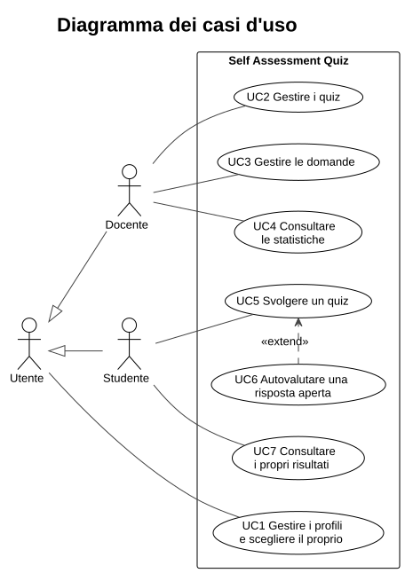

# 1. Specifica dei requisiti

## 1.1 Scopo del sistema

Self Assessment Quiz è un'applicazione web per l'autovalutazione. I docenti creano quiz composti da domande a scelta multipla e a risposta aperta; gli studenti li svolgono e ricevono subito il punteggio.

Il sistema non corregge automaticamente le risposte aperte: lo studente confronta la propria risposta con quella attesa indicata dal docente e dichiara se è giusta. È il senso stesso dell'autovalutazione, e l'unica soluzione affidabile senza un correttore umano.

## 1.2 Attori

| Attore | Descrizione |
|--------|-------------|
| Utente | Chiunque apra l'applicazione. Sceglie o crea un profilo. |
| Docente | Specializzazione di Utente. Crea e gestisce quiz e domande, consulta le statistiche. |
| Studente | Specializzazione di Utente. Svolge i quiz e consulta i propri risultati. |

## 1.3 Requisiti funzionali

| Codice | Requisito | Caso d'uso |
|--------|-----------|------------|
| RF1 | Creare, elencare (divisi per ruolo) ed eliminare profili; scegliere il profilo con cui entrare. | UC1 |
| RF2 | Il docente crea, modifica ed elimina i propri quiz. | UC2 |
| RF3 | Il docente aggiunge, modifica ed elimina domande: a scelta multipla (da 2 a 4 opzioni, esattamente una corretta) o aperte (con risposta attesa obbligatoria). | UC3 |
| RF4 | Lo studente svolge un quiz rispondendo a tutte le domande. Non può consegnare con risposte mancanti e non vede le soluzioni durante lo svolgimento. | UC5 |
| RF5 | Per le domande aperte lo studente può leggere la risposta attesa e dichiara se la propria è giusta o sbagliata. | UC6 |
| RF6 | Il sistema corregge le domande a scelta multipla, applica l'autovalutazione alle aperte, calcola il punteggio (un punto per domanda) e salva il tentativo. | UC5 |
| RF7 | Lo studente consulta lo storico dei propri tentativi e il dettaglio di ciascuno. | UC7 |
| RF8 | Il docente consulta, per ogni quiz, numero di tentativi, punteggio medio e percentuale di risposte corrette per domanda. | UC4 |

## 1.4 Requisiti non funzionali

| Codice | Requisito |
|--------|-----------|
| RNF1 | Frontend in HTML, CSS e JavaScript; backend in PHP; comunicazione solo tramite API REST di tipo CRUD in JSON. Il backend non genera HTML. |
| RNF2 | Architettura Model-View-Presenter su entrambi i lati. |
| RNF3 | Nessun framework: architettura, routing e accesso ai dati scritti a mano; Bootstrap solo per l'impaginazione. |
| RNF4 | Avvio dell'intero sistema con un solo comando tramite Docker Compose. |
| RNF5 | Sicurezza di base: query parametrizzate, nessun HTML costruito con dati dell'utente, soluzioni mai inviate allo studente. |
| RNF6 | Interfaccia responsive con tema scuro, messaggi di errore e di conferma comprensibili. |

## 1.5 Casi d'uso

| Caso d'uso | Attore | Descrizione |
|------------|--------|-------------|
| UC1 Gestire i profili | Utente | Crea o elimina un profilo; sceglie con quale entrare. |
| UC2 Gestire i quiz | Docente | Crea un quiz con titolo e descrizione, lo modifica o lo elimina. |
| UC3 Gestire le domande | Docente | Aggiunge, modifica o elimina le domande di un quiz. |
| UC4 Consultare le statistiche | Docente | Vede l'andamento degli studenti su un quiz. |
| UC5 Svolgere un quiz | Studente | Risponde alle domande e consegna; riceve l'esito. |
| UC6 Autovalutare una risposta aperta | Studente | Estende UC5 quando il quiz contiene domande aperte. |
| UC7 Consultare i propri risultati | Studente | Rivede i tentativi passati. |

I due casi d'uso centrali, descritti per esteso.

### UC3 — Gestire le domande

| | |
|---|---|
| **Attore** | Docente |
| **Precondizione** | Il docente ha aperto uno dei propri quiz. |
| **Flusso principale** | 1. Il docente scrive il testo e sceglie il tipo. 2. Per la scelta multipla inserisce da 2 a 4 opzioni e ne marca una corretta; per la risposta aperta scrive la risposta attesa. 3. Salva. 4. Il sistema valida e aggiunge la domanda al quiz. |
| **Flussi alternativi** | 2a. Dati non validi (meno di due opzioni, nessuna o più di una corretta, risposta attesa vuota): il sistema mostra il motivo e non salva. 1a. Il docente sceglie *Modifica* su una domanda esistente: il form si riempie e il salvataggio la aggiorna. 1b. Il docente sceglie *Elimina*: dopo conferma la domanda viene rimossa. |
| **Postcondizione** | Il quiz contiene la domanda aggiornata. |

### UC5 — Svolgere un quiz

| | |
|---|---|
| **Attore** | Studente |
| **Precondizione** | Esiste almeno un quiz con almeno una domanda. |
| **Flusso principale** | 1. Lo studente sceglie un quiz. 2. Il sistema mostra le domande senza rivelare le soluzioni. 3. Lo studente risponde; per le aperte si autovaluta (UC6). 4. Consegna. 5. Il sistema corregge, salva il tentativo e mostra punteggio e dettaglio. |
| **Flussi alternativi** | 4a. Mancano risposte: il sistema evidenzia le domande incomplete e non consegna. 3a. Lo studente annulla: le risposte non vengono salvate. |
| **Postcondizione** | Il tentativo compare nello storico dello studente e nelle statistiche del docente. |

## 1.6 Vincoli e assunzioni

- **Nessuna autenticazione.** L'utente sceglie il proprio profilo da un elenco. È una scelta coerente con uno strumento di autovalutazione; per un uso reale andrebbe aggiunto un sistema di login.
- **Ogni domanda vale un punto.**
- **Un tentativo si svolge in una sola sessione**: chiudendo la pagina prima di consegnare, le risposte vanno perse.
