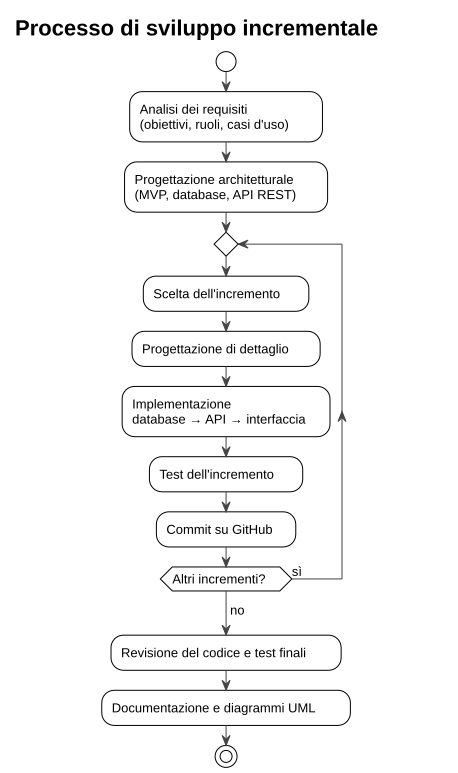

# 2. Processo di sviluppo

## 2.1 Modello adottato

Il progetto segue un modello **incrementale**. Dopo un'analisi iniziale dei requisiti e una progettazione architetturale di massima, il sistema è stato costruito per incrementi successivi: ognuno aggiunge una funzionalità completa, dal database all'interfaccia, e viene provato prima di passare al successivo.

Il modello è stato scelto per due motivi:

- **ogni incremento produce qualcosa di funzionante e verificabile**: gli errori emergono subito e restano circoscritti all'ultima parte aggiunta;
- **le decisioni di dettaglio si prendono quando servono**, con il resto del sistema già in piedi. Per esempio, la gestione delle risposte aperte tramite autovalutazione è stata definita durante l'incremento dello svolgimento, non all'inizio.

## 2.2 Incrementi

| # | Incremento | Contenuto | Verifica |
|---|------------|-----------|----------|
| 1 | Struttura e infrastruttura | Docker Compose, immagine Apache + PHP, schema del database | i container si avviano e lo schema viene creato |
| 2 | Base del backend | front controller, Router, JsonView, connessione al database | l'API risponde in JSON, 404 sulle rotte inesistenti |
| 3 | Profili | API `/users`, home page, Model del frontend, classi di supporto delle View | creazione, elenco ed eliminazione dall'interfaccia |
| 4 | Quiz, domande e statistiche | API di quiz, domande e statistiche, area docente | CRUD completo con validazione e controllo di proprietà |
| 5 | Svolgimento e risultati | strategie di correzione, API dei tentativi, area studente con storico | consegna, punteggio, soluzioni nascoste |
| 6 | Test automatici | test di unità e di integrazione | tutti i test passano |
| 7 | Interfaccia | tema scuro e rifinitura grafica | test di accettazione ripetuti |
| 8 | Documentazione | README, documenti e diagrammi UML | coerenza fra documenti e codice |

## 2.3 Strumenti

| Strumento | Uso |
|-----------|-----|
| Git e GitHub | versionamento |
| Docker Compose | ambiente di esecuzione riproducibile (Apache + PHP 8.2, MySQL 8) |
| Visual Studio Code | sviluppo |
| PlantUML | diagrammi UML, scritti come testo in `docs/uml/` |
| Strumenti per sviluppatori del browser | ispezione delle chiamate all'API e del DOM |
| IA generativa | supporto a progettazione, implementazione e documentazione; ogni parte è stata verificata ed eseguita |

## 2.4 Gestione del repository

Il codice è sul ramo `main`, con un commit per incremento (tabella 2.2). I messaggi indicano il tipo di modifica: `feat`, `fix`, `test`, `refactor`, `docs`.
