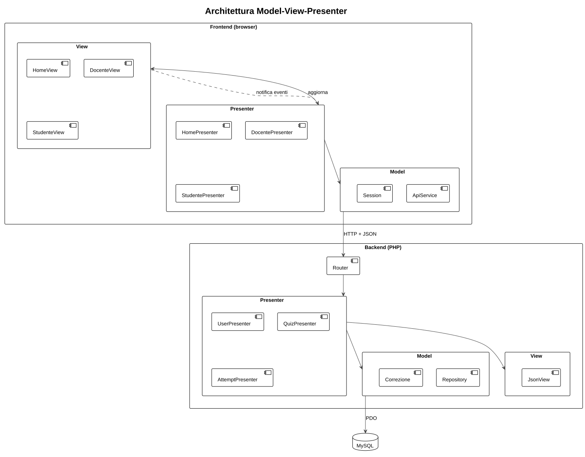
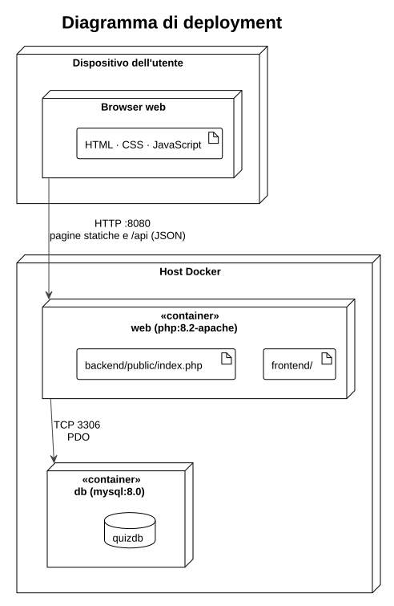

# 3. Architettura

## 3.1 Vista d'insieme

Il sistema è un'applicazione client-server in tre livelli:

- il **frontend** (HTML, CSS, JavaScript) gira nel browser e costruisce le pagine;
- il **backend** (PHP) espone un'API REST che risponde solo in JSON;
- il **database** (MySQL) conserva i dati.

Frontend e backend comunicano esclusivamente tramite l'API. Poiché il backend non produce mai HTML, può essere riscritto in un altro linguaggio (Java, Go…) senza toccare il frontend, e viceversa, purché resti lo stesso contratto: le rotte descritte nel capitolo 5.

## 3.2 Model-View-Presenter

Il pattern MVP divide il codice in tre ruoli:

- **Model** — dati e regole del dominio;
- **View** — presentazione e raccolta degli input; non prende decisioni;
- **Presenter** — riceve gli eventi dalla View, usa il Model, dice alla View cosa mostrare.

A differenza di MVC, View e Model non comunicano mai direttamente: passa tutto dal Presenter. Il pattern è applicato su entrambi i lati.

| Ruolo | Frontend | Backend |
|-------|----------|---------|
| Model | `ApiService` (accesso all'API), `Session` (utente corrente) | Repository (accesso ai dati), `Correzione` (regole di correzione), `Database` |
| View | `HomeView`, `DocenteView`, `StudenteView`, che estendono `Osservabile`, con le utilità di `Dom` | `JsonView`: la "vista" del backend è la risposta JSON |
| Presenter | `HomePresenter`, `DocentePresenter`, `StudentePresenter` | `UserPresenter`, `QuizPresenter`, `AttemptPresenter`, raggiunti tramite il `Router` |

Regole rispettate in tutto il codice:

1. **solo `ApiService` usa `fetch()`**: nessun'altra classe conosce gli URL dell'API;
2. **solo le View toccano il DOM**: i Presenter non contengono `document`;
3. **le View non conoscono i Presenter**: notificano gli eventi dell'utente (per esempio `salvaQuiz`) e il Presenter si registra per ascoltarli (pattern Observer, 4.3);
4. **solo i Repository contengono SQL** e **solo `JsonView` scrive la risposta HTTP**.

## 3.3 Deployment

Docker Compose avvia due container:

- **web** (`php:8.2-apache`): pubblica `frontend/` come radice del sito e inoltra `/api` al front controller `backend/public/index.php`. Solo `backend/public` è raggiungibile dal browser; `backend/src` resta privato;
- **db** (`mysql:8.0`): al primo avvio esegue `docker/db/init.sql` e crea lo schema; i dati restano in un volume.

Frontend e API stanno sulla stessa origine, quindi non serve configurare CORS.

## 3.4 Principi di progettazione

Il codice segue i principi SOLID dove portano un beneficio concreto.

| Principio | Applicazione |
|-----------|--------------|
| **S** — Single responsibility | Ogni classe ha un solo compito: il `Router` smista, i Presenter validano e rispondono, i Repository accedono ai dati, `JsonView` scrive la risposta, le classi `Correzione` valutano una risposta. |
| **O** — Open/closed | Un nuovo tipo di domanda (per esempio vero/falso) richiede una nuova classe `Correzione` e una voce nella mappa di `AttemptRepository`, senza modificare il ciclo di correzione. |
| **L** — Liskov substitution | `CorrezioneAutomatica` e `Autovalutazione` sono intercambiabili: chi le usa conosce solo l'interfaccia `Correzione`. |
| **I** — Interface segregation | `Correzione` espone un solo metodo, `valuta()`. |
| **D** — Dependency inversion | Rispettato nella correzione: `AttemptRepository` dipende dall'astrazione `Correzione`, non dalle implementazioni. Non applicato fra Presenter e Repository, che i Presenter creano direttamente: con una sola implementazione per Repository un'astrazione in più non porterebbe vantaggi. |

## 3.5 Sicurezza di base

- query sempre parametrizzate, contro la SQL injection;
- dati inseriti nella pagina con `textContent` e mai con `innerHTML`, contro l'XSS;
- allo studente il quiz arriva senza l'indicazione delle risposte corrette.
