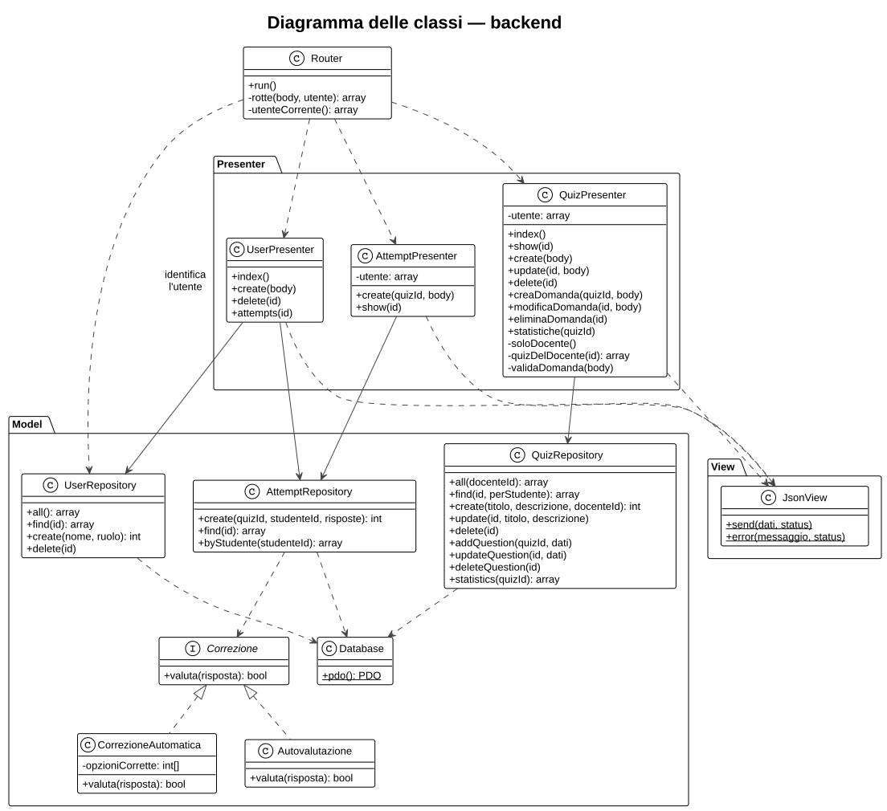
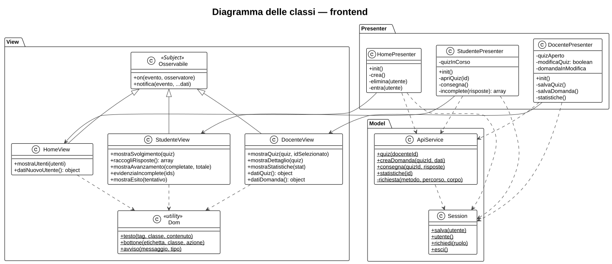
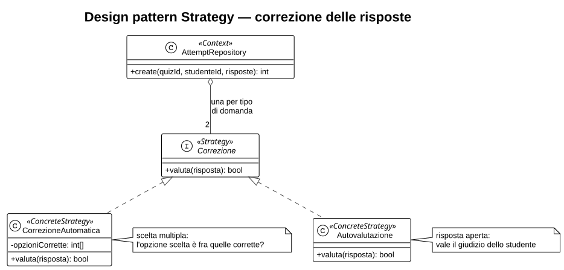
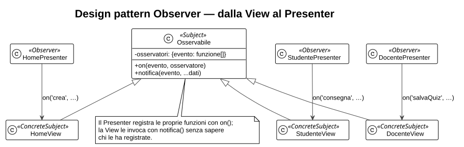
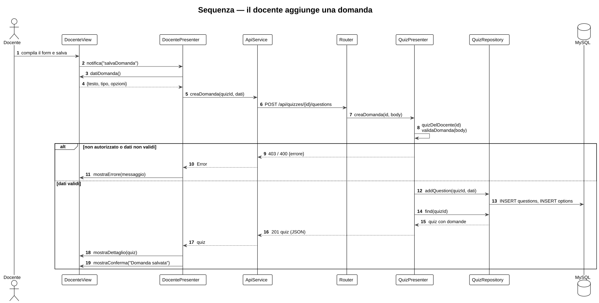
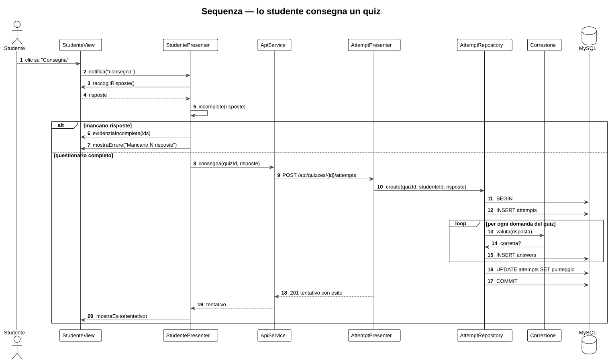
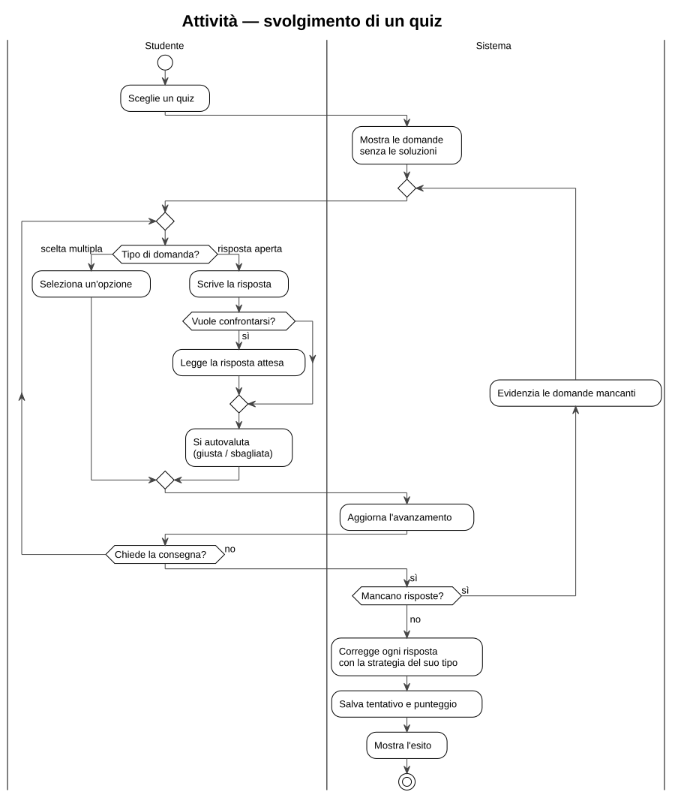
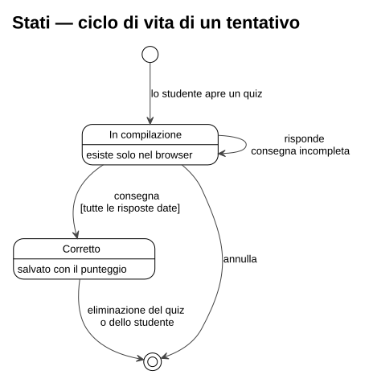

# 4. Progettazione di dettaglio

## 4.1 Classi del backend



| Classe | Responsabilità |
|--------|----------------|
| `index.php` | Front controller: carica le classi e avvia il `Router`. |
| `Router` | Associa metodo HTTP e percorso a un metodo di un Presenter; identifica l'utente dall'header `X-User-Id`; trasforma le eccezioni in risposte di errore. |
| `UserPresenter` | Profili e storico dei tentativi. |
| `QuizPresenter` | Quiz, domande e statistiche; controlla che il quiz appartenga al docente che fa la richiesta e valida le domande. |
| `AttemptPresenter` | Consegna e consultazione dei tentativi. |
| `UserRepository`, `QuizRepository`, `AttemptRepository` | Accesso ai dati con PDO. `AttemptRepository` calcola il punteggio in una transazione. |
| `Correzione` e implementazioni | Regola di correzione di una risposta (pattern Strategy, 4.3). |
| `Database` | Connessione PDO condivisa. |
| `JsonView` | Scrive la risposta JSON con il codice di stato. |

## 4.2 Classi del frontend



Ogni pagina ha una coppia View–Presenter: `index.html` (scelta del profilo), `docente.html` (quiz, domande, statistiche), `studente.html` (svolgimento e risultati).

Lo stato della schermata sta nel Presenter, non nella View. Per esempio `DocentePresenter` ricorda quale quiz è aperto (`quizAperto`) e se il form della domanda sta creando o modificando (`domandaInModifica`); `StudentePresenter` ricorda il quiz in corso e decide quando una risposta è completa.

## 4.3 Design pattern

### Strategy — correzione delle risposte

**Problema.** Le domande a scelta multipla e quelle aperte si correggono in modo diverso: le prime confrontando l'opzione scelta con quella corretta, le seconde accettando il giudizio dello studente. Con un `if` sul tipo di domanda, ogni nuovo tipo richiederebbe di modificare il codice del calcolo del punteggio.

**Soluzione.** Ogni regola di correzione è una classe che implementa l'interfaccia `Correzione`. `AttemptRepository` (il *Context*) prepara una strategia per tipo di domanda e, per ogni risposta, chiama `valuta()` senza sapere quale regola sta usando.



```php
$correzioni = [
    'scelta_multipla' => new CorrezioneAutomatica($this->opzioniCorrette($quizId)),
    'risposta_aperta' => new Autovalutazione(),
];
// ...
$corretta = $correzioni[$tipo]->valuta($risposta);
```

**Vantaggi.** Le regole si provano in isolamento (test U1–U5, capitolo 6); aggiungere un tipo di domanda significa aggiungere una classe.

### Observer — comunicazione dalla View al Presenter

**Problema.** In MVP la View deve avvisare il Presenter quando l'utente agisce (clic su *Salva*, *Consegna*…), ma non deve conoscerlo: altrimenti le due classi diventerebbero inseparabili e la View non sarebbe più sostituibile.

**Soluzione.** Le tre View estendono `Osservabile`, il *Subject*. Ogni azione dell'utente diventa un evento con un nome, notificato con `notifica()`. Il Presenter, l'*Observer*, si registra con `on()` agli eventi che gli interessano. La View invoca le funzioni registrate senza sapere chi le ha fornite.



```js
// nella View: l'utente ha premuto "Salva domanda"
this.notifica('salvaDomanda');

// nel Presenter: registrazione dell'osservatore
view.on('salvaDomanda', () => this.salvaDomanda());
```

**Vantaggi.** La dipendenza va in un solo verso, dal Presenter alla View. Nel JavaScript gli osservatori sono funzioni anziché oggetti con un metodo `update()`: è la forma idiomatica del pattern nel linguaggio, la stessa di `addEventListener`.

### Pattern architetturali

Oltre ai due pattern precedenti, il progetto usa tre pattern architetturali:

- **Model-View-Presenter**, su entrambi i lati (capitolo 3);
- **Front Controller**: tutte le richieste all'API passano da `backend/public/index.php` e dal `Router`;
- **Repository**: l'accesso ai dati è isolato in classi dedicate, una per area del dominio.

`Database` fornisce un'unica connessione condivisa (singleton).

## 4.4 Comportamento dinamico

### Il docente aggiunge una domanda



I controlli avvengono nel backend, perché l'API è raggiungibile anche senza passare dall'interfaccia: `quizDelDocente` verifica che il quiz sia del docente che fa la richiesta, `validaDomanda` che la domanda sia completa. In caso di errore il messaggio del server arriva fino alla View.

### Lo studente consegna un quiz



Due aspetti da notare:

- **transazione**: il tentativo e tutte le sue risposte si salvano insieme o per niente;
- **il ciclo scorre le domande del database**, non le risposte ricevute: una domanda non inviata conta come sbagliata e il client non può alzare il punteggio omettendo domande.

### Svolgimento di un quiz



### Ciclo di vita di un tentativo



Finché è in compilazione, il tentativo esiste solo nel browser (`quizInCorso` in `StudentePresenter`): annullando non resta traccia. Alla consegna completa diventa una riga di `attempts` con il suo punteggio, e sparisce solo se vengono eliminati il quiz o lo studente.
