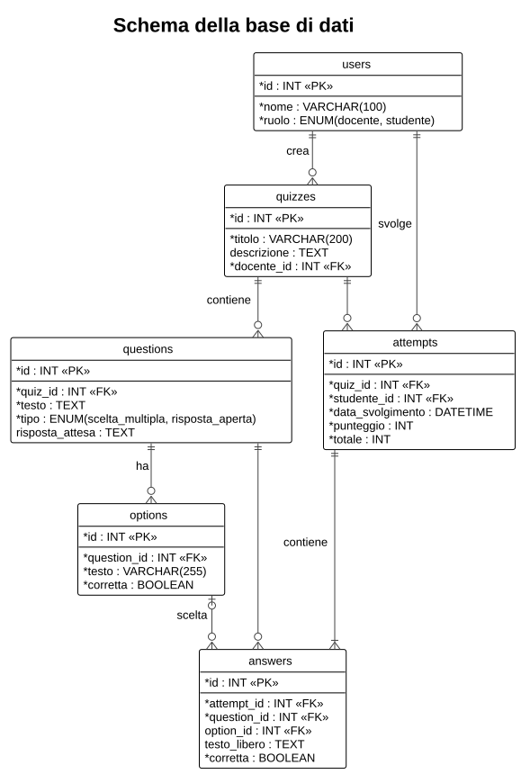

# 5. Dati e API

## 5.1 Base di dati



| Tabella | Contenuto |
|---------|-----------|
| `users` | Profili, con ruolo `docente` o `studente`. |
| `quizzes` | Quiz, ciascuno di un docente. |
| `questions` | Domande di un quiz; `risposta_attesa` solo per le aperte. |
| `options` | Opzioni delle domande a scelta multipla; `corretta` indica quella giusta. |
| `attempts` | Tentativi: uno studente, un quiz, data, punteggio e totale. |
| `answers` | Una risposta per ogni domanda di un tentativo, con l'esito. |

Scelte di progetto:

- **cancellazione a cascata** (`ON DELETE CASCADE`): eliminando un quiz spariscono domande, opzioni, tentativi e risposte; eliminando un utente spariscono i suoi quiz o i suoi tentativi. La coerenza è garantita dal database;
- **punteggio salvato nel tentativo**, non ricalcolato: se il docente modifica le domande dopo lo svolgimento, lo storico resta quello che lo studente ha visto;
- **`answers.corretta` vale per entrambi i tipi**: per le aperte contiene l'autovalutazione. Statistiche e punteggio trattano così tutte le domande allo stesso modo;
- **date in UTC**: il backend salva e restituisce gli orari in UTC, il browser li mostra nel fuso orario dell'utente;
- **`answers.option_id` diventa `NULL`** se l'opzione viene eliminata modificando la domanda: l'esito della risposta resta registrato.

Lo schema completo è in `docker/db/init.sql`.

## 5.2 API REST

Convenzioni:

- formato JSON in richiesta e risposta; gli errori hanno la forma `{"errore": "messaggio"}`;
- l'utente corrente si indica con l'header `X-User-Id`;
- codici di stato: `200` ok, `201` creato, `204` eseguito senza contenuto, `400` dati non validi, `403` ruolo non autorizzato, `404` risorsa inesistente, `500` errore del server.

| Metodo | Percorso | Operazione | Ruolo |
|--------|----------|------------|-------|
| GET | `/api/users` | elenco dei profili | — |
| POST | `/api/users` | crea un profilo | — |
| DELETE | `/api/users/{id}` | elimina un profilo | — |
| GET | `/api/users/{id}/attempts` | storico dei tentativi | — |
| GET | `/api/quizzes` | elenco dei quiz; `?docente_id=` filtra per docente | — |
| GET | `/api/quizzes/{id}` | quiz con domande; `?perStudente=1` nasconde le soluzioni | — |
| POST | `/api/quizzes` | crea un quiz | docente |
| PUT | `/api/quizzes/{id}` | modifica un quiz | docente |
| DELETE | `/api/quizzes/{id}` | elimina un quiz | docente |
| GET | `/api/quizzes/{id}/statistics` | statistiche del quiz | docente |
| POST | `/api/quizzes/{id}/questions` | aggiunge una domanda con le sue opzioni | docente |
| PUT | `/api/questions/{id}` | modifica una domanda e le sue opzioni | docente |
| DELETE | `/api/questions/{id}` | elimina una domanda | docente |
| POST | `/api/quizzes/{id}/attempts` | consegna le risposte; il server corregge | studente |
| GET | `/api/attempts/{id}` | esito di un tentativo | — |

Le opzioni non hanno rotte proprie: viaggiano dentro la domanda e vengono riscritte a ogni modifica. Le domande si creano sotto il loro quiz, ma si modificano ed eliminano con il proprio id, che è già univoco.

### Esempio: aggiungere una domanda

```http
POST /api/quizzes/1/questions
X-User-Id: 1
Content-Type: application/json

{
  "testo": "Quale comando elimina le righe di una tabella?",
  "tipo": "scelta_multipla",
  "opzioni": [
    { "testo": "DELETE", "corretta": true },
    { "testo": "DROP",   "corretta": false }
  ]
}
```

Risposta `201`: il quiz aggiornato con tutte le sue domande.

### Esempio: consegnare un quiz

```http
POST /api/quizzes/1/attempts
X-User-Id: 2
Content-Type: application/json

{
  "risposte": [
    { "question_id": 1, "option_id": 1 },
    { "question_id": 2, "testo_libero": "Collega due tabelle", "corretta": true }
  ]
}
```

Risposta `201`: il tentativo con `punteggio`, `totale` e il dettaglio di ogni risposta. Per le domande aperte `corretta` è l'autovalutazione dello studente.
